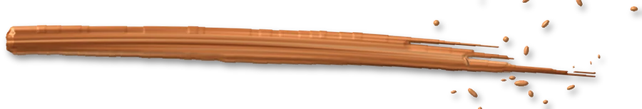

# Portfolio — DA « Le Sanctuaire nocturne »

Tu appliques une DA **déjà validée**. Tu n’inventes pas de nouvelle couleur, police ou effet. En cas de doute : `docs/DA.md` fait foi, puis tu demandes.

## Avant de toucher un fichier

1. Lis `docs/DA.md` (concept, palette, typo, lumière, pigment, composants, checklist).
2. Lis `AGENTS.md`, `docs/ARCHITECTURE.md`, `docs/SECURITY.md` (règles projet : pas de `<style>`/`<script>` inline, pas de `style=""` → la CSP est `style-src 'self'`, couleurs uniquement dans `src/styles/variables.css`, BEM, en-tête JSDoc ligne 1).
3. Si tu travailles une page projet : la page HTML est la source des textes (textes validés par Léandre, jamais réécrits) ; utilise uniquement les assets de `src/assets/projects/<slug>/`.

## Les 6 règles qui ne se discutent pas

1. **Une scène par écran** : fond nuit + une seule source de lumière (feu, haut gauche) + un geste de pigment.
2. **Couleurs** : uniquement les tokens de `variables.css`. Pigments = cuivre, or patiné, vert phtalo (+ reflet `--color-pigment-phtalo-glint`). Jamais rose, bleu électrique, violet, rouge.
3. **Pigment = gouache en relief**, pas de craie trouée, pas de néon plat. Utilise les textures `src/assets/decor/paint/*.webp` (relief intégré) ou leurs silhouettes `silhouettes/*.svg`, sans `mix-blend-mode: screen`.
4. **Typo** : Ubuntu (structure), Updock (1–2 mots, discret, jamais une signature), Ubuntu Mono (cartels/métadonnées). Le logo LV or est la seule signature.
5. **Images projets étalonnées** « Odyssée » (classe `.is-graded`, voir recette) — toutes cohérentes entre elles.
6. **Conservés** : buste 3D du hero, pinceau du curseur. On améliore, on ne remplace pas.

## Recettes (CSS dans `src/styles/components/*.css`, jamais inline)

### Étalonnage d’image « Odyssée »
```css
/* components/graded-image.css */
.graded-image { position: relative; overflow: hidden; background: var(--color-abyss); }
.graded-image__img { display: block; width: 100%; height: 100%; object-fit: cover;
  filter: brightness(0.68) contrast(1.2) saturate(0.58) sepia(0.12);
  transition: filter var(--duration-normal) var(--ease-out); }
.graded-image::after { content: ""; position: absolute; inset: 0; pointer-events: none;
  background:
    linear-gradient(150deg, color-mix(in srgb, var(--color-light-fire) 22%, transparent) 0%, transparent 42%),
    radial-gradient(ellipse at 50% 50%, transparent 45%, color-mix(in srgb, var(--color-abyss) 75%, transparent) 100%),
    linear-gradient(180deg, transparent 55%, color-mix(in srgb, var(--color-pigment-phtalo-deep) 35%, transparent) 100%); }
.graded-image:hover .graded-image__img { filter: brightness(0.82) contrast(1.2) saturate(0.6) sepia(0.12); }
```

### Faisceau de lumière + poussière (section)
```css
.light-beam { position: absolute; top: -20%; left: 8%; width: 28rem; height: 140%; pointer-events: none;
  background: linear-gradient(180deg, color-mix(in srgb, var(--color-light-fire) 30%, transparent), transparent 80%);
  transform: rotate(-24deg); filter: blur(32px); mix-blend-mode: screen; }
@media (prefers-reduced-motion: reduce) { .light-beam__dust { display: none; } }
```
Poussière : petits points `--color-light-fire` dans le faisceau uniquement, animation de dérive lente (6–14 s), désactivée en reduced-motion.

### Cartel (étiquette d’œuvre)
```html
<dl class="cartel cartel--lab-horizon">
  <dt class="cartel__title">Lab Horizon</dt>
  <dd class="cartel__meta">N° I · 2026 · SAE 501</dd>
  <dd class="cartel__stack">React · Laravel · Docker</dd>
</dl>
```
```css
.cartel { margin: 0; padding-left: var(--space-4); border-left: 2px solid var(--cartel-pigment, var(--color-ember));
  font-family: var(--font-mono); font-size: var(--text-sm); color: var(--color-text-muted); }
.cartel__title { font-family: var(--font-heading); font-weight: 700; font-size: var(--text-2xl); color: var(--color-text); }
.cartel--lab-horizon { --cartel-pigment: var(--color-project-lab-horizon); }
/* idem --magicallab, --micromonde, --visualcom, --village-jeunes, --secondary */
```

### Titre de section « collision » (+ gravure fantôme optionnelle)
```html
<h2 class="section-title">
  <span class="section-title__main">Projets</span>
  <span class="section-title__gesture" aria-hidden="true">récents</span>
</h2>
<span class="ghost-word" aria-hidden="true">SALLE I</span>
```
Le texte accessible du h2 doit rester complet : ajouter `<span class="visually-hidden">récents</span>` si le mot Updock est `aria-hidden`.
`.section-title__gesture` : Updock, `font-size: clamp(3rem, 7vw, 6.5rem)`, rotation -5°, dégradé cuivre doux via `background-clip: text` (couleurs = tokens `--color-pigment-copper-light`/`--color-pigment-copper`), opacité 0.85, chevauche le mot principal (marge négative).
`.ghost-word` : Ubuntu 700, ~14rem, `color: transparent; -webkit-text-stroke: 1px var(--color-border)`, positionné en absolu derrière, masqué < 48rem.

### Geste de pigment (décor)
```html

```
Pas de `mix-blend-mode`. Un geste par zone, 2 pigments max. Masquer ou réduire sous 48rem. Phtalo : ajouter le `drop-shadow` glint de `docs/DA.md §6`. Catalogue : `docs/DA.md §6` (swipe, underline, smear-vertical-trio, impasto-cluster, splat, bloom-trio, drip, droplets).

Silhouette recolorée au pigment du projet (ex. carte) :
```css
.project-card__stain {
  background: var(--project-pigment, var(--color-pigment-copper));
  mask: url("/src/assets/decor/paint/silhouettes/splat-copper.svg") center / contain no-repeat;
}
```

### Carte projet (survol)
Carte = `.graded-image` + cartel. Au survol/focus : `translateY(-10px)`, `box-shadow` liseré 1 px + halo au pigment du projet (`color-mix(... 35%, transparent)`), apparition (opacity/clip-path) d’un `swipe-*.webp` / `underline-*.webp` au pigment du projet en bas de l’image (ou silhouette `mask` recolorée). Focus clavier = même rendu (`:focus-visible`).

### Pinceau du curseur (évolution)
Fichiers : `src/scripts/features/home-brush/*`. Garder l’API `initHomeBrush`. Cibles : trait plein et opaque (plus de petites ellipses dispersées), largeur pilotée par la vitesse avec effilement au début et à la fin du geste, couleur interpolée cuivre → or → phtalo le long du trait, `mix-blend-mode: normal` dans `home.css`. Palette lue depuis `--color-splash-*` (déjà repointés).

### Buste 3D
`bust-hero-scene.ts › createLights()` : key = `--color-light-fire`, rim = `--color-light-steel`, fill marbre doux. Ne pas toucher à la physique ni au chargement.

## Validation (obligatoire avant de dire « fini »)

1. `npm run gate` (typecheck + secrets + tests + build) — vert.
2. `npm run test:e2e` si une page publique a changé.
3. Checklist `docs/DA.md §9` cochée.
4. Capture desktop 1440 px + mobile 390 px de la page modifiée, comparée à la planche DA (`docs/DA.md` → planches 03 et 06).
5. Si un test fige une ancienne décision (ex. carrousel d’accueil), mets à jour le test **dans le même changement** et explique pourquoi.
